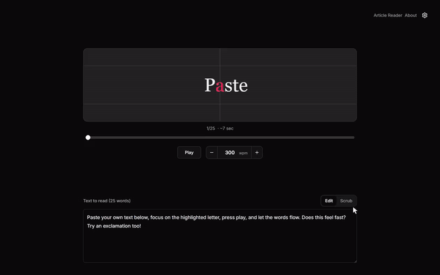
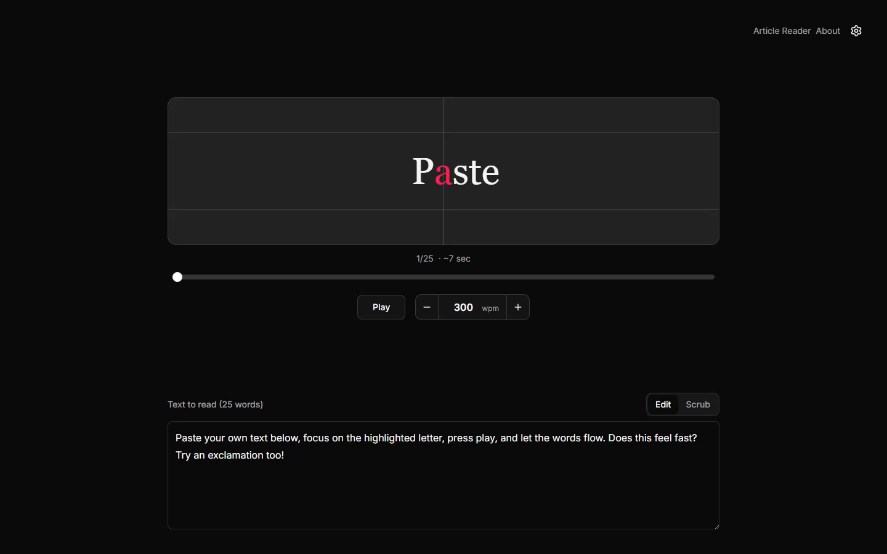

# WordFlash

WordFlash uses rapid serial visual presentation (RSVP) to show one word at a time in the same spot on screen. Each word highlights a single focal character so your eyes stay put instead of scanning left to right.

## Demo



<details>
<summary>Screenshot</summary>



</details>

Paste text or give it a URL. For URLs it pulls the article body with [Mozilla Readability](https://github.com/mozilla/readability) and reads it back in the same word-by-word view.

[Live demo](https://wordflashreader.vercel.app)

Built with [Next.js](https://nextjs.org), [React](https://react.dev), and [Tailwind CSS](https://tailwindcss.com).

## What you get

- Focal-character highlighting with configurable color, font, and WPM
- Natural punctuation and line-break pauses, plus extra time for unfamiliar names, numbers, and long words ([timing rules](docs/reading-timing.md))
- Article reader with the full text beside the RSVP panel; click a word to jump
- A bookmarklet ("Read in WordFlash") for opening the current page in the reader
- Light, dark, and system themes; reduce motion and reduce transparency toggles
- Reading position saved in the browser when you come back

## Repo layout

```
wordflash/
├── apps/web/       Next.js app
├── functions/      Firebase Cloud Function for /api/extract
├── packages/core/  Word timing, parsing, focal index
└── package.json    Bun workspaces
```

## Development

Use [Bun](https://bun.sh) for the workspace commands and Node.js 22 for the web and Firebase runtimes. The repo uses Bun workspaces; Node alone does not run the commands below.

```bash
bun install
bun run dev
```

Dev server: [http://localhost:3000](http://localhost:3000)

| Command | What it does |
|---------|--------------|
| `bun run dev` | Web dev server |
| `bun run build` | Build core + web |
| `bun run lint` | Lint all packages |
| `bun run test` | Run all tests |

Watch tests in one package:

```bash
cd packages/core && bun run test:watch
cd apps/web && bun run test:watch
```

Production build:

```bash
bun run build
bun run --filter wordflash start
```

## Deploy

**Vercel:** Create a project from this repo and set **Root Directory** to `apps/web`. See the [Next.js deploy docs](https://nextjs.org/docs/app/building-your-application/deploying) if you need the details.

**Firebase:** `firebase.json` hosts the web app and routes `/api/extract` to the `extract` Cloud Function in `functions/`. Install the Functions dependencies with `bun install --cwd functions` and authenticate the Firebase CLI before running `firebase deploy`. The predeploy hook builds the Functions code. Review `.firebaserc` and choose your own Firebase project before deployment.
